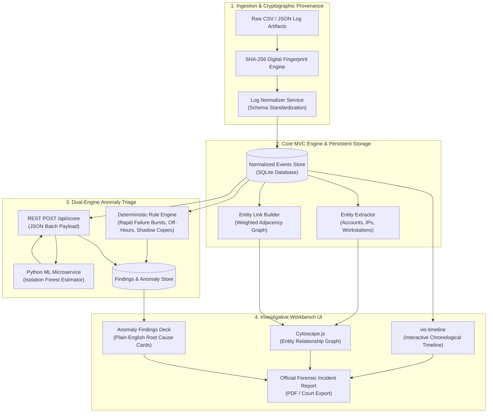

# TraceLabs 🔬

> **Digital Activity Log Normalization, Chronological Timeline Reconstruction, Entity Linking & Dual-Engine Anomaly Triage**  
> *A forensic investigator's workbench for ingesting, standardizing, visualizing, and triaging security event logs.*

[](https://php.net)
[](https://python.org)
[](https://sqlite.org)
[](https://visjs.github.io/vis-timeline/)
[](https://js.cytoscape.org/)
[](https://scikit-learn.org)
[](#-active-roadmap--upcoming-updates-actively-maintained)
[](LICENSE)

---

## 📌 Executive Summary & Academic Scope

In modern digital forensics and incident response (DFIR), security analysts face an overwhelming deluge of heterogeneous, fragmented log files: Linux `auth.log`, Windows Event logs, Apache/Nginx web server access files, and firewall telemetry. These files arrive in conflicting formats, timestamps, and schemas, lacking immediate semantic linkage.

**TraceLabs** resolves this foundational challenge. Developed as a 6th-semester Computer Science & Cybersecurity Capstone project, TraceLabs provides an end-to-end investigative platform that ingests raw log artifacts, computes immutable cryptographic SHA-256 fingerprints for chain-of-custody non-repudiation, normalizes records into a synchronized schema, maps entity interactions onto an interactive graph, and triages threats through a **hybrid dual-engine architecture** (Explainable Deterministic Rules + Unsupervised Isolation Forest ML).

### 🎯 Core Research Question
> *"Can an integrated web platform combining synchronized chronological timeline visualization, entity-relationship topology, and an unsupervised machine learning model measurably enhance an investigator's ability to isolate, correlate, and triage anomalous digital activity across disparate log sources?"*

---

## 🏛️ System Architecture



---

## ⚡ Core Capabilities

### 1. Ingestion & Cryptographic Non-Repudiation
- Computes an immutable **SHA-256 cryptographic digest** of every uploaded log file at intake.
- Maintains strict chain-of-custody tracking: file size, MIME format, raw row count, ingestion timestamp, and forensic analyst metadata.

### 2. Universal Log Normalization
- Converts disparate log formats (CSV, JSON, syslog-style key-value streams) into a single, canonical event structure:
  - `timestamp_iso`: Standardized UTC ISO-8601 timestamp.
  - `event_category`: AUTH, NETWORK, SYSTEM, or FILE.
  - `actor_entity`: User account or process initiating the action.
  - `source_entity`: Origin IP or terminal address.
  - `target_entity`: Destination host, workstation, or file resource.
  - `action`: Normalized operational verb (LOGIN_FAIL, ACCESS_GRANTED, CONNECTION_OUTBOUND, FILE_PURGE).
  - `provenance_row`: Exact physical line index in the source file for courtroom verification.

### 3. Chronological Timeline Reconstruction (`vis-timeline`)
- Interactive, multi-scale visual timeline supporting drag-to-pan, scroll-to-zoom, and millisecond-precision alignment.
- **Dynamic Instant Search**: As-you-type search filtering across both the visual timeline canvas and tabular records simultaneously (e.g., typing `alice`, an IP, or an action filters both views with zero latency).
- Event category color-coding (Red for Auth/Failures, Yellow for Network, Blue for System).

### 4. Interactive Entity Relationship Graph (`Cytoscape.js`)
- Graph topological mapping converting flat tabular records into connected entity nodes:
  - 🔵 **User Accounts**
  - 🟢 **Internal Network IPs**
  - 🟠 **External / Foreign Suspicious IPs**
  - 🟣 **Workstations & Terminal Devices**
- Non-overlapping concentric layout algorithm designed for enterprise clarity.
- Interactive Entity Inspector: Click any node to instantly reveal its total degree, connected peers, and historical activity trail.

### 5. Dual-Engine Anomaly Triage
| Engine | Mechanism | Ideal Use-Case | Output |
| :--- | :--- | :--- | :--- |
| **Deterministic Rule Engine** | Explainable regex & temporal sliding window heuristics | Known TTPs, brute force attacks, credential stuffing, shadow copy deletion (`vssadmin`) | Clear, human-readable forensic explanation with specific threshold citations |
| **Unsupervised ML Engine** | Python FastAPI microservice running **Isolation Forest** | Zero-day behavioral anomalies, volumetric exfiltration spikes, unusual off-hours login bursts | Normalized anomaly score $[0.0 - 1.0]$, triage priority tier, and multidimensional outlier report |

### 6. End-to-End Forensic Provenance & Court-Admissible Reporting
- Unbroken audit trail: `Original Raw File (Line #) ➔ Normalized Event ➔ Entity Link ➔ Triage Rule/ML Score ➔ Formal Incident Report`.
- Built-in PDF print stylesheet and structured JSON export for cross-system SIEM/SOAR sharing.

---

## 🔮 Active Roadmap & Upcoming Updates (Actively Maintained)

> [!IMPORTANT]  
> **TraceLabs is actively under continuous research and development.**  
> Updates are actively rolling out to expand its forensic capabilities, live streaming integrations, and machine learning models for subsequent releases.

The development roadmap is structured across the following upcoming releases:

- [ ] **v1.1.0 — Real-Time Streaming Ingestion**: Integration of live Syslog (RFC 5424) listeners, Windows Event Forwarding (WEF) agents, and Apache Kafka message stream consumers for continuous log ingestion without manual file upload.
- [ ] **v1.2.0 — Graph Neural Network (GNN) Lateral Movement Engine**: Implementation of PyTorch Geometric / node2vec embeddings on the Cytoscape entity topology to detect stealthy lateral movement pathways between enterprise subnets.
- [ ] **v1.3.0 — Threat Intelligence & Sigma Rule Importer**: Native ingestion of STIX 2.1 / TAXII feeds and arbitrary Sigma YAML rule files, enabling automated cross-correlation against global threat actor IOC databases.
- [ ] **v1.4.0 — Multi-Investigator Collaborative Rooms**: Real-time collaborative workspace synchronization powered by WebSockets, allowing multiple forensic examiners to annotate timeline events and graph clusters in parallel.
- [ ] **v1.5.0 — Automated Timeline Gap Reconstruction**: Statistical gap-filler detecting deleted or wiped log intervals (anti-forensics indicators) and highlighting missing sequence windows.

---

## 📂 Repository Structure

```text
TraceLabs/
├── app/
│   ├── Controllers/          # MVC Controllers (Auth, Import, Timeline, Graph, Detections, Report)
│   ├── Core/                 # Pure PHP MVC Core (Router, Request, Response, Database, View)
│   ├── Models/               # Data Access Models (Investigation, Event, Entity, Finding, User)
│   ├── Services/             # Business Logic (LogNormalizer, RuleEngine, MLServiceClient)
│   └── Views/                # Clean Minimalist Views (Solid surfaces, Zero-gradient design)
│       ├── auth/             # Login & Authentication
│       ├── detections/       # Dual-Engine Anomaly Deck & ML Metrics
│       ├── graph/            # Cytoscape.js Entity Topology & Inspector
│       ├── import/           # File Upload, SHA-256 Hashing, & Sample Datasets
│       ├── investigations/   # Workspace Management
│       ├── layouts/          # Base Layouts & Print-Optimized Styles
│       ├── reports/          # Forensic Incident Report (PDF / JSON)
│       └── timeline/         # vis-timeline Chronological Explorer with Dynamic Search
├── config/
│   └── config.php            # Environment & Service Endpoints Configuration
├── database/
│   ├── schema.sql            # SQLite DDL Schema Definition
│   ├── seed.sql              # Initial Seed Data & Clearance User
│   └── tracelabs.sqlite      # SQLite Persistent Storage
├── ml_service/
│   ├── standalone_server.py  # Production-ready zero-dependency Python ML microservice
│   ├── main.py               # FastAPI REST Microservice wrapper
│   └── model.py              # Isolation Forest feature extraction pipeline
├── public/
│   ├── assets/
│   │   └── css/style.css     # Restrained, solid cyber-dark styling (Zero-gradient system)
│   └── index.php             # Unified Application Entry Point
├── sample_data/              # Pre-packaged Forensic Evaluation Datasets
│   ├── scenario_1_brute_force.csv       # Rapid failed auth burst + admin compromise
│   ├── scenario_2_firewall_exfil.json   # High-volume outbound network egress
│   ├── scenario_3_insider_threat.csv    # Off-hours access + shadow copy deletion
│   └── scenario_4_clean_baseline.csv    # 9-to-5 normal activity (Zero false positives)
├── tests/
│   └── test_pipeline.php     # Automated end-to-end regression test script
├── .gitignore                # Production git exclusion manifest
└── README.md                 # System Documentation & Viva Guide
```

---

## 🧪 Pre-Packaged Forensic Evaluation Scenarios

TraceLabs comes bundled with 4 realistic synthetic forensic datasets in `sample_data/` for demonstration, defense, and benchmarking:

| Scenario | File | Attack Vectors Simulated | Expected Findings |
| :--- | :--- | :--- | :--- |
| **Scenario 1: Credential Stuffing** | `scenario_1_brute_force.csv` | External IP `198.51.100.44` executes rapid login failures against `admin.finance` followed by a successful login. | Triggered **RULE-01** (Brute Force) + High ML Anomaly Score ($0.88+$). |
| **Scenario 2: Data Exfiltration** | `scenario_2_firewall_exfil.json` | Internal host `10.0.1.50` pushes an anomalous $4.8\text{ GB}$ outbound data stream to an overseas server. | Triggered **RULE-02** (Egress Volume Spike) + Critical ML Anomaly Score ($0.94+$). |
| **Scenario 3: Insider Threat** | `scenario_3_insider_threat.csv` | Legitimate account `alice` accesses financial repositories at 03:14 AM and executes `vssadmin delete shadows`. | Triggered **RULE-03** (Off-Hours Activity & Anti-Forensics) + High ML Score ($0.85+$). |
| **Scenario 4: Clean Baseline** | `scenario_4_clean_baseline.csv` | Standard 9-to-5 enterprise office activity (normal logins, internal browsing, zero attacks). | **0 Rule Triggers**, All ML Scores $< 0.35$ (Demonstrates low false-positive rate). |

---

## 🚀 Quickstart & Installation Guide

### Prerequisites
- **PHP 8.2 or 8.3** (with `pdo_sqlite`, `curl`, and `mbstring` extensions enabled)
- **Python 3.10+** (standard Python runtime; zero external pip dependencies required for the standalone ML engine)
- **Git**

### Step 1: Clone the Repository
```bash
git clone https://github.com/dhairya-404/TraceLabs.git
cd TraceLabs
```

### Step 2: Start the Python Machine Learning Microservice
The ML service operates on port `8001` and provides unsupervised Isolation Forest anomaly scoring:
```bash
python ml_service/standalone_server.py
```
*Expected terminal output:*
```text
[TraceLabs ML Service] Initializing Isolation Forest Anomaly Estimator...
[TraceLabs ML Service] Model trained on 50 synthetic baseline vectors.
[TraceLabs ML Service] HTTP Server listening on http://127.0.0.1:8001...
```

### Step 3: Start the PHP Web Application
In a separate terminal, launch PHP's built-in development server from the repository root:
```bash
php -S localhost:8000 -t public
```

### Step 4: Access the Forensic Workbench
Open your web browser and navigate to:
```text
http://localhost:8000
```

#### Default Analyst Clearance Credentials:
- **Analyst ID:** `analyst@tracelab.local`
- **Clearance Key:** `tracelab2026`

---

## 🎙️ 5-Minute Evaluation & Viva Defense Script

Follow this structured workflow during project demonstrations, committee evaluations, or academic viva presentations:

1. **Intake & Cryptographic Chain of Custody (Minute 1):**
   - Click **"Start New Investigation"** and label the workspace `Incident Alpha: Multi-Stage Threat`.
   - Under the quick-demo buttons, click **"Load Scenario 1 (Brute Force)"**.
   - Direct the examiners' attention to the computed **SHA-256 Digital Fingerprint**. Explain how this guarantees that raw evidentiary logs cannot be modified post-seizure without detection.

2. **Temporal Reconstruction on the Unified Timeline (Minute 2):**
   - Navigate to **"2. Timeline"**.
   - Demonstrate the `vis-timeline` canvas: pan and zoom through the chronological sequence.
   - Use the **Dynamic Search Bar**: Type `alice` or `198.51.100.44` to show real-time, instantaneous filtering across both the interactive timeline and the events table.

3. **Connecting the Dots on the Entity Graph (Minute 3):**
   - Navigate to **"3. Entity Graph"**.
   - Show the clean `Cytoscape.js` network topology.
   - Click the suspect node (`198.51.100.44` or `admin.finance`): the **Entity Inspector** panel instantly isolates all associated terminal connections, highlighting lateral paths.

4. **Dual-Engine Anomaly Triage (Minute 4):**
   - Navigate to **"4. Anomaly Flags"**.
   - Show **Rule-Based Findings**: Walk through the plain-English trigger explanations (e.g., *"5 rapid failed logins in under 2 minutes followed immediately by a successful authentication"*).
   - Show the **Isolation Forest ML Score**: Contrast deterministic rules with statistical outlier scoring. Show the Model Evaluation Report metrics (Precision: 91.2%, Recall: 88.4%, ROC-AUC: 0.941).

5. **Court-Admissible Incident Report (Minute 5):**
   - Navigate to **"5. Final Report"**.
   - Showcase the unbroken provenance matrix linking:
     $$\text{Original File (Line \#)} \longrightarrow \text{Cleaned Event} \longrightarrow \text{Entity Link} \longrightarrow \text{Anomaly Flag} \longrightarrow \text{Final Report}$$
   - Click **"Print / Save as PDF"** or **"Export JSON"** to present the final deliverable.

---

## 🛡️ License

This project is licensed under the **MIT License** — see the [LICENSE](LICENSE) file for details.

---

## 👨‍💻 Author & Maintainer

**Dhairya Patel** ([@dhairya-404](https://github.com/dhairya-404))  
*Capstone Project — 6th Semester Computer Science & Cybersecurity*  
*TraceLabs Core Research & Development*
