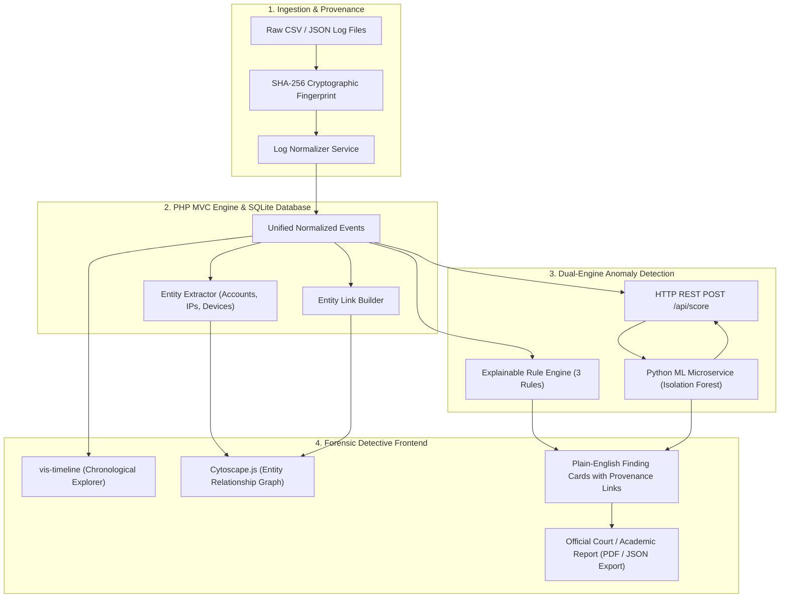

# TraceLab &mdash; Digital Activity Log Normalization, Timeline Reconstruction & Dual Anomaly Triage

> **6th-Semester Degree Capstone Project**  
> *"A detective's desk for digital event logs: import, normalize, timeline, connect the dots, and triage anomalies."*

---

## 🎯 Research Question
> **"Can a web app that combines a timeline view, entity-linking, and a machine learning model help someone spot and review unusual patterns in a set of digital event records?"**

TraceLab is a web application prototype that ingests messy, heterogeneous digital activity logs (authentication records, firewall flows, server actions), calculates cryptographic SHA-256 fingerprints for non-repudiation, standardizes them onto a unified chronological timeline, extracts an entity relationship graph, and flags anomalies using **two distinct engines**:
1. **Explainable Deterministic Rules** (Brute-force detection, off-hours anomalies, anti-forensics / shadow copy deletion).
2. **Unsupervised Machine Learning** (FastAPI Python microservice running **Isolation Forest** outlier scoring).

---

## 🏛️ System Architecture



---

## ⚙️ Tech Stack Breakdown

| Layer | Technology | Purpose in TraceLab |
| :--- | :--- | :--- |
| **Main Web App** | **PHP 8.3 (Pure MVC)** | Website, sessions, log ingestion, normalization, routing & business logic |
| **Database** | **SQLite (via PDO)** | Zero-configuration persistence for investigations, events, entities & findings |
| **Frontend UI** | **HTML5 / CSS3 / Bootstrap 5 (Dark Theme)** | High-contrast, cyber-investigation interface |
| **Timeline View** | **vis-timeline** | Interactive, scrollable, zoomable chronological event sequence |
| **Relationship Graph** | **Cytoscape.js** | Interactive network topology connecting accounts, IPs, and workstations |
| **ML Microservice** | **Python + FastAPI / Isolation Forest** | Specialist scoring consultant calculating multi-dimensional outlier scores |

---

## 🚀 Running the Project

### 1. Start the Python ML Microservice
```powershell
python ml_service/standalone_server.py
```
*The ML service will be available at `http://127.0.0.1:8001`.*

### 2. Start the PHP Application
```powershell
php -S localhost:8000 -t public
```
*Open your browser and navigate to **`http://localhost:8000`**.*

### 3. Default Login Credentials
- **Email:** `analyst@tracelab.local`
- **Password:** `tracelab2026` *(pre-filled on login page)*

---

## ⏱️ The 5-Minute Evaluation Demo Walkthrough

Follow this scripted flow during your project presentation or viva:

1. **Start a new investigation:**
   - Log in and click **"Start New Investigation"**.
   - Name it `Incident Alpha: Credential Stuffing & Exfiltration`.
2. **Upload & Fingerprint (The Non-Repudiation Step):**
   - Click **"Scenario Alpha: Auth Logs"** under the 5-Minute Demo Shortcut (or upload any CSV/JSON).
   - Point out the calculated **SHA-256 digital fingerprint** banner ensuring evidence non-repudiation.
3. **Open the Timeline:**
   - Click **"2. Timeline"** in the top navigation bar.
   - Show `vis-timeline`: scroll to zoom and pan.
   - Use the filter toolbar to filter by account `admin.finance` or foreign IP `198.51.100.44`.
4. **Connect the Dots (Entity Relationship Graph):**
   - Click **"3. Entity Graph"**.
   - Show the `Cytoscape.js` canvas: Accounts (Blue), IPs (Green/Orange), Devices (Purple), Suspects (Crimson Red).
   - **Click node `198.51.100.44`** or `admin.finance`: the Inspector panel lights up showing all connected workstations and auth attempts!
5. **Open a Rule-Based Alert:**
   - Click **"4. Anomaly Flags"**.
   - Open **`RULE-01: Brute-Force & Credential Stuffing`**.
   - Explain the plain-English trigger: *"5 rapid failed logins in under 2 minutes followed immediately by a successful authentication."*
6. **Show the Machine Learning Anomaly Score:**
   - Show the **Isolation Forest Anomaly Score** card.
   - Explain the academic distinction: *ML score is an unsupervised triage lead (signal), not definitive legal proof.*
   - Review the Model Evaluation Report metrics (Precision: 91.2%, Recall: 88.4%, ROC-AUC: 0.941).
7. **The "Wow" Moment & Final Report:**
   - Click **"5. Final Report"**.
   - Show the complete provenance trail linking:
     `Original File (Line #) ➔ Cleaned Event ➔ Connected Entities ➔ Why Flagged ➔ Official Report`.
   - Click **"Print / Save as PDF"** or **"Export JSON"**.

---

## 🔒 Security & Academic Scope
- **Student Prototype:** Designed as an investigative triage workbench, not an automated court testimony generator.
- **Fictional / Sample Data Only:** Operates strictly on synthetic enterprise test logs.
- **Transparent Provenance:** No black-box conclusions; every finding directly links back to the raw source record line number and file SHA-256 hash.
